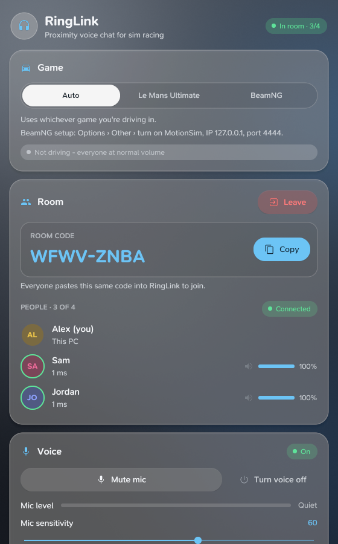
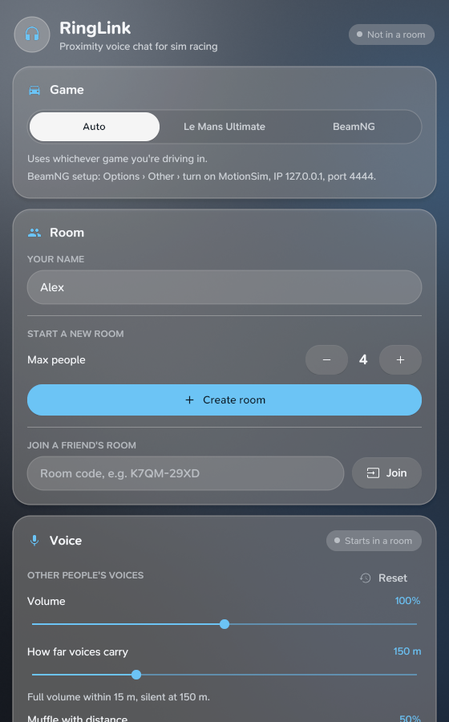
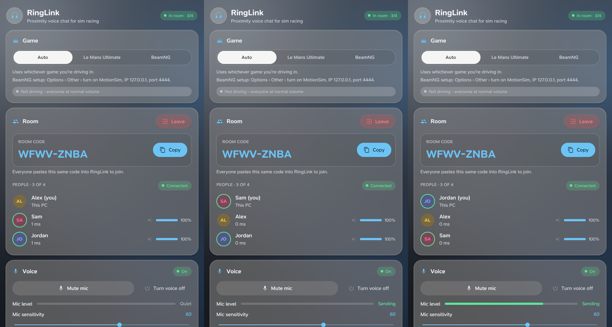

# RingLink

Proximity voice chat for **Le Mans Ultimate** and **BeamNG.drive**: the closer someone's car is to yours, the louder they are. Further away they fade out and can be muffled, like you're actually hearing them on track.

<p align="center">
  
  &nbsp;
  
</p>

## How to use

1. Open RingLink (`RingLink.exe` on Windows, `ringlink-linux` on Linux).
2. One person sets **Max people** (2-8) and clicks **Create room**.
3. Send the room code (like `K7QM-29XD`) to your friends.
4. Everyone else pastes the code and clicks **Join room**.

Voice starts automatically once you're in a room. When you're on the same LMU server or BeamMP map, each person's volume follows the distance between your cars. Anywhere else (menus, garage, different servers) it's normal voice chat.

You can set how loud everyone is, how far voices carry, how muffled they get with distance, and your mic sensitivity.

### Game setup

Pick your game at the top of the window: **Auto** (whichever game you're driving in), **Le Mans Ultimate** or **BeamNG**.


- **Le Mans Ultimate:** nothing to set up. RingLink reads your car position from LMU's local REST API (`127.0.0.1:6397`).
- **BeamNG.drive / BeamMP:** in *Options > Other*, turn on **MotionSim** with IP `127.0.0.1` and port `4444`.

Use headphones so nobody hears themselves echo.

## How it works

- **Rooms:** the room code is the only thing you share. Each member posts a small announcement (name and network address) to a topic on [ntfy.sh](https://ntfy.sh), a free public message relay. The topic name and the encryption key both come from the room code (Argon2id + XChaCha20-Poly1305), so the relay only ever sees ciphertext.
- **Voice:** everyone connects directly to everyone else with UDP hole punching (STUN to find public addresses). Audio is 16 kHz mono G.711 mu-law in 20 ms frames, encrypted with the room key. Nothing goes through a server.
- **Proximity:** each app reads its own car position (LMU REST API or BeamNG MotionSim UDP) and shares it with the room. Distances are only compared between people in the same game.
- **Audio I/O:** Windows uses winmm (no extra installs). Linux uses `parec`/`pacat`, `pw-record`/`pw-play` or `arecord`/`aplay`, whichever is installed.

Anyone with a room's code can join it, so only share codes with people you want in.

## Building

Requires Go 1.26+.

```sh
go test ./...
go build -o ringlink-linux .                                                  # Linux (needs cgo for the Gio UI)
GOOS=windows GOARCH=amd64 go build -ldflags "-H windowsgui" -o RingLink.exe .  # Windows
```

For screenshots or testing without a microphone, build with `-tags fakeaudio`: the mic "talks" every few seconds and sound output is discarded.

UI built with [Gio](https://gioui.org), using the [SN Pro](https://github.com/supernotes/sn-pro) font (SIL Open Font License 1.1, see `fonts/OFL.txt`).

<p align="center"></p>

## License

[PolyForm Noncommercial 1.0.0](LICENSE): free to use, change and share for any **noncommercial** purpose. You may not sell RingLink or use it commercially. Anyone who shares it or a changed version must include the license and this notice:

> Required Notice: Copyright (c) 2026 djpek (https://github.com/djpek/RingLink)
