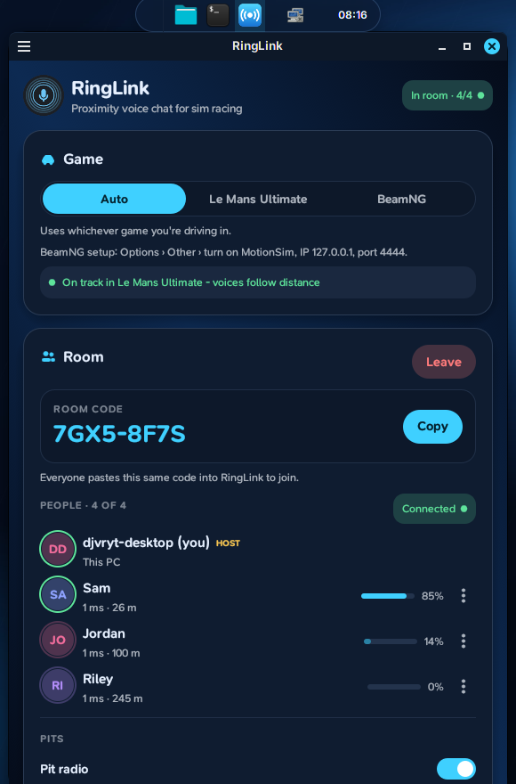
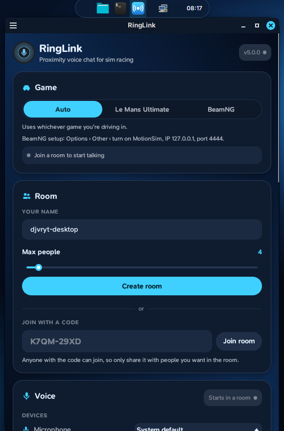
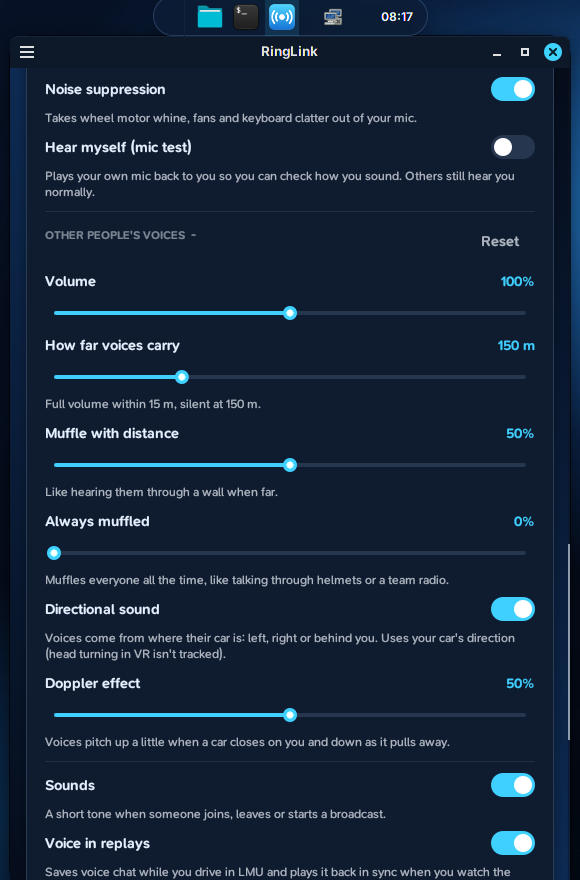
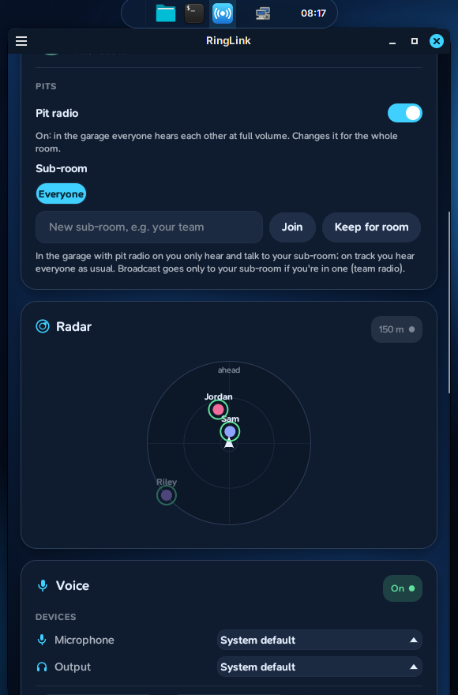
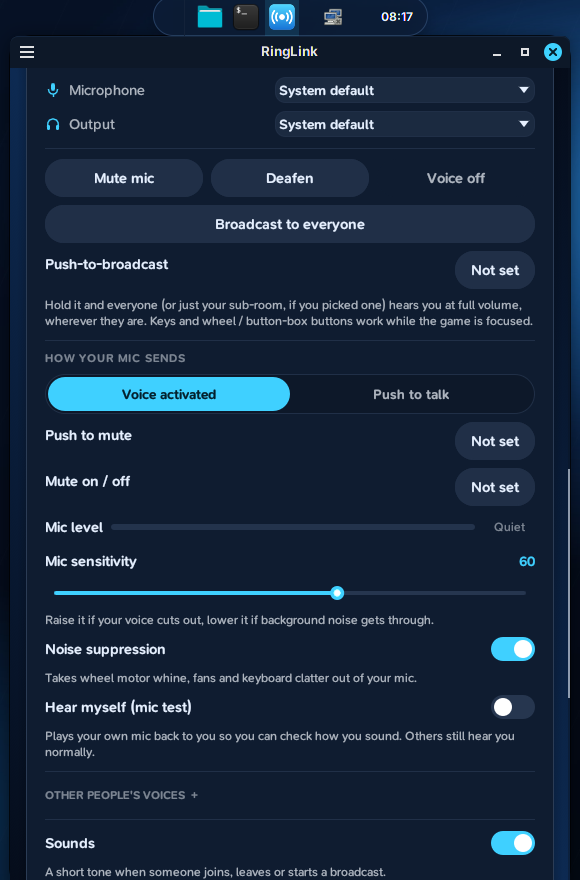

# RingLink

Proximity voice chat for **Le Mans Ultimate** and **BeamNG.drive**: the closer someone's car is to yours, the louder they are. Further away they fade out and can be muffled, like you're actually hearing them on track.

<p align="center">
  
  &nbsp;
  
</p>

**RingLink 5** is a rewrite in Rust. It keeps every feature of 4.2 and adds more (see [What's new in 5](#whats-new-in-5)), but it **can't talk to RingLink 4**: everyone in a room needs version 5. RingLink 4 (Go) is still on the [`v4-go`](../../tree/v4-go) branch.

## How to use

1. Open RingLink (`RingLink5.exe` on Windows, `ringlink5-linux` on Linux; run `chmod +x ringlink5-linux` once).
2. One person sets **Max people** (2-40) and clicks **Create room**.
3. Send the room code (like `K7QM-29XD`) to your friends.
4. Everyone else pastes the code and clicks **Join room**. **Rejoin** gets you back into the last room you were in.

Voice starts automatically once you're in a room. When you're on the same LMU server or BeamMP map, each person's volume follows the distance between your cars. Anywhere else (menus, garage, different servers) it's normal voice chat.

Under **Appearance** you can make RingLink see-through, with separate sliders for the background and for panels & buttons, keep it **always on top**, and show or hide the **radar**.

Pick your **microphone** and **output** in the Voice panel (or leave them on System default).

You can set how loud everyone is, how far voices carry, how muffled they get with distance, and your mic sensitivity.

`ringlink5-linux --demo` (or `RingLink5.exe --demo`) opens a room with pretend drivers so you can look around without a game, mic or friends.

### Voice features

<p align="center"></p>

- **Directional sound:** voices come from where their car is, left, right or behind you (stereo, follows your car's direction; head turning in VR isn't tracked).
- **Always muffled:** muffles everyone all the time, like talking through helmets or a team radio. It's a slider now, so it can be anywhere from a little to a lot.
- **Doppler effect:** a car closing on you sounds slightly higher, one pulling away slightly lower. Also a slider.
- **Push to talk / push to mute / mute on-off:** choose **Voice activated** or **Push to talk** under *How your mic sends*, and bind push-to-talk, push-to-mute and a mute toggle to a key or a wheel / button-box button.
- **Mute mic, Deafen, Voice off:** quick buttons at the top of the Voice panel. Deafen stops you hearing everyone (your mic still sends).
- **Noise suppression:** takes wheel-motor whine, fans and keyboard clatter out of your mic (RNNoise).
- **Hear myself (mic test):** plays your own mic back to you so you can check how you sound.
- **Sounds:** a short tone when someone joins, leaves or starts a broadcast.
- **Per-person volume and copying settings:** the ⋮ next to someone in the room opens their own volume slider (remembered by name) and **Copy their voice settings**, which copies their "other people's voices" settings to yours.
- **Host and mods:** whoever makes the room is the host (shown next to their name). In someone's ⋮ menu the host can **Make mod**, and the host and mods can **Mute for everyone** (their RingLink stops sending, and everyone else's drops their voice too). Nobody can mute the host. Changes are signed with the host's or mod's own key, so knowing the room code isn't enough to fake them.

<p align="center"></p>

- **Pits: pit radio, sub-rooms, isolate:** the host and mods can turn **Pit radio** on or off for the room (on: in the garage everyone hears each other at full volume; off: the garage works by distance like everywhere else), add permanent sub-rooms with **Keep for room**, and **Isolate for everyone** from someone's ⋮ menu (everyone hears only that person, the rest faded). Anyone can make a sub-room (e.g. a team) by typing a name and clicking **Join**, and everyone can pick it while someone's in it. In the garage with pit radio on you only hear and talk to your sub-room; on track you hear everyone as usual.
- **Radar:** a small map of who's around your car.

<p align="center"></p>

- **Broadcast to everyone:** click **Broadcast to everyone**, or bind **Push-to-broadcast** to a keyboard key or a wheel / button-box button and hold it. Everyone (or just your sub-room, if you picked one, like team radio) hears you at full volume, centred, until you let go. Works while the game is focused (Windows; Linux on X11, e.g. Linux Mint. On Wayland only wheel buttons work).
- **Voice in replays (LMU):** while you drive, RingLink saves the talking (yours and what you receive, even people too far away to hear, and even with voice chat off). When you watch that session's replay later, even after restarting the game, the voices play again at the right moments and come from the cars. Slow motion and fast forward (0.2x to 4x) play the voice in step; pausing, rewinding and fast skipping stay quiet. Live voice is heard normally (full volume) while you watch. Recordings are matched to a replay by track, time **and who was in the session**, so a different session at the same track is never played; if one ever is, **Wrong session** stops it for good. The last 30 sessions are kept in RingLink's settings folder under `voice-replays`. Tick **Keep my voice out of replays** to opt out: other people's RingLink won't save your voice, and yours won't either.

### Game setup

Pick your game at the top of the window: **Auto** (whichever game you're driving in), **Le Mans Ultimate** or **BeamNG**.

- **Le Mans Ultimate:** nothing to set up. RingLink reads your car position from LMU's local REST API (`127.0.0.1:6397`).
- **BeamNG.drive / BeamMP:** in *Options > Other*, turn on **MotionSim** with IP `127.0.0.1` and port `4444`.

Use headphones so nobody hears themselves echo.

## What's new in 5

- **Opus voice** at 48 kHz instead of G.711: clearer, about a sixth of the upload, and lost packets are rebuilt or smoothed over instead of clicking.
- **Noise suppression**, **radar**, **Deafen**, **mic test**, a **mute on/off** binding, **join / leave / broadcast sounds**, **Rejoin**, **always on top**.
- **Always muffled** and **Doppler** are sliders instead of switches.
- **Replay voice fix:** recordings are matched by who was in the session too, and **Wrong session** stops a mismatched one for good.
- Signed host / mod changes with a far-future timestamp are refused (they could block later changes).
- Windows audio uses WASAPI instead of winmm.

Settings are read from the same file as RingLink 4, so your name, devices, per-person volumes and wheel-button bindings carry over. On Windows, wheel-button bindings need setting once more (they're read a different way now).

## How it works

- **Rooms:** the room code is the only thing you share. Each member posts a small announcement (name and network address) to a topic on [ntfy.sh](https://ntfy.sh), a free public message relay. The topic name and the encryption key both come from the room code (Argon2id + XChaCha20-Poly1305), so the relay only ever sees ciphertext.
- **Voice:** everyone connects directly to everyone else with UDP hole punching (STUN to find public addresses). Audio is 48 kHz Opus in 20 ms frames, encrypted with the room key, and mixed to stereo on playback. Nothing goes through a server.
- **Big rooms:** up to 40 people. Everyone tells the room who they reach directly; when two people can't connect directly (or it's much slower), their voice goes through whoever has the quickest path to both, passed on still encrypted. In rooms over 8, cars more than 600 m away (further than anyone's range setting) get your voice at a much lower bitrate, so it's still in their replays but upload stays low.
- **Proximity:** each app reads its own car position (LMU REST API or BeamNG MotionSim UDP) and shares it with the room. Distances are only compared between people in the same game. Positions are moved forward along each car's velocity between updates (LMU only updates them 5 times a second), and your direction comes from how your car moves.
- **Replays:** LMU's session clock (`/rest/watch/sessionInfo`) timestamps the recorded voice; the replay position comes from LMU's `ws://127.0.0.1:6398/websocket/replaymetrics` stream.
- **Audio I/O:** Windows uses WASAPI (no extra installs). Linux uses `parec`/`pacat`, `pw-record`/`pw-play` or `arecord`/`aplay`, whichever is installed; device lists come from `pactl`.

Anyone with a room's code can join it, so only share codes with people you want in.

## Building

Requires Rust (stable) and `cmake` (for Opus). No audio or GUI development packages are needed.

```sh
cargo test
cargo build --release                                   # Linux
cargo build --release --target x86_64-pc-windows-gnu    # Windows (needs mingw-w64)
```

UI built with [egui](https://github.com/emilk/egui), using the [SN Pro](https://github.com/supernotes/sn-pro) font (SIL Open Font License 1.1, see `assets/OFL.txt`).

## License

[PolyForm Noncommercial 1.0.0](LICENSE): free to use, change and share for any **noncommercial** purpose. You may not sell RingLink or use it commercially. Anyone who shares it or a changed version must include the license and this notice:

> Required Notice: Copyright (c) 2026 djpek (https://github.com/djpek/RingLink)
