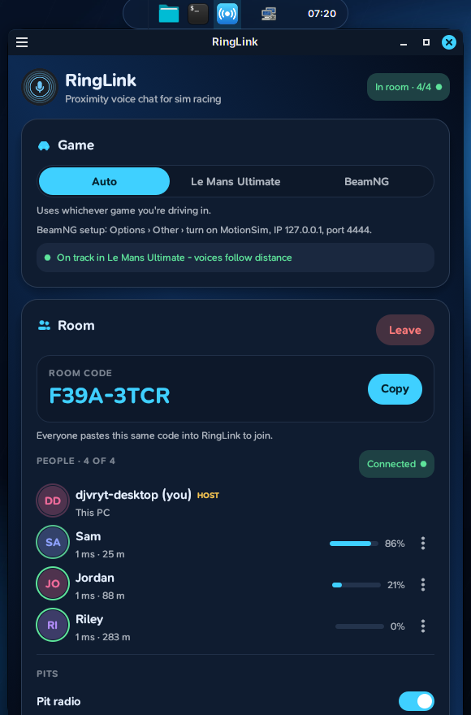

# RingLink 5 (Rust)

Proximity voice chat for **Le Mans Ultimate** and **BeamNG.drive**: the closer someone's car is to yours, the louder they are.

This is a rewrite of RingLink 4 (Go) in Rust. It keeps every feature of 4.2 and is **not compatible with it**: everyone in a room needs version 5. RingLink 4 is still on the [`v4-go`](../../tree/v4-go) branch.



## What's new in 5

- **Opus voice** at 48 kHz instead of G.711: clearer, about a sixth of the upload, and lost packets are rebuilt or smoothed over instead of clicking.
- **Noise suppression** (RNNoise) takes wheel-motor whine, fans and keyboard clatter out of your mic.
- **Radar**: a small map of who's around your car.
- **Replay voice fix**: recordings are matched to a replay by track, time *and who was in the session*, so a different session at the same track is never played. If it ever is, **Wrong session** stops it for good.
- **Deafen**, **mic test** (hear yourself), a **mute on/off** binding, **join / leave / radio sounds**, **Rejoin** for the last room, **always on top**.
- Signed host / mod changes with a far-future timestamp are refused (they could block later changes).

Settings are read from the same file as RingLink 4, so your name, devices, per-person volumes and wheel-button bindings carry over. On Windows, wheel-button bindings need setting once more (they're read a different way now).

## Use

1. Open RingLink (`RingLink5.exe` on Windows, `ringlink5-linux` on Linux; run `chmod +x ringlink5-linux` once).
2. One person sets **Max people** and clicks **Create room**, then sends the code to everyone.
3. Everyone else pastes the code and clicks **Join room**.

- **Le Mans Ultimate:** nothing to set up (reads `127.0.0.1:6397`).
- **BeamNG.drive / BeamMP:** *Options > Other*, turn on **MotionSim** with IP `127.0.0.1`, port `4444`.

`ringlink5-linux --demo` opens a room with pretend drivers so you can look around without a game or friends.

## How it works

- **Rooms:** the room code is the only thing you share. Members post a small encrypted announcement (name, network address) to a topic on [ntfy.sh](https://ntfy.sh); topic and key both come from the code (Argon2id + XChaCha20-Poly1305), so the relay only sees ciphertext.
- **Voice:** everyone connects directly to everyone else over UDP (STUN + hole punching). When two people can't reach each other, whoever has the quickest path to both passes the still-encrypted packets on. In rooms over 8, cars more than 600 m away get a low-bitrate stream (enough for their replays).
- **Proximity:** each app reads its own car position and shares it; volume, muffling, left/right and Doppler follow from that.
- **Audio I/O:** Linux uses `parec`/`pacat`, `pw-record`/`pw-play` or `arecord`/`aplay`; Windows uses WASAPI.

## Build

```sh
cargo test
cargo build --release                                   # Linux
cargo build --release --target x86_64-pc-windows-gnu    # Windows (needs mingw-w64 and cmake)
```

Linux build needs `cmake` (for Opus). No audio or GUI development packages are required.

## License

[PolyForm Noncommercial 1.0.0](LICENSE). Required Notice: Copyright (c) 2026 djpek (https://github.com/djpek/RingLink)

Font: [SN Pro](https://github.com/supernotes/sn-pro) (SIL Open Font License 1.1, `assets/OFL.txt`).
